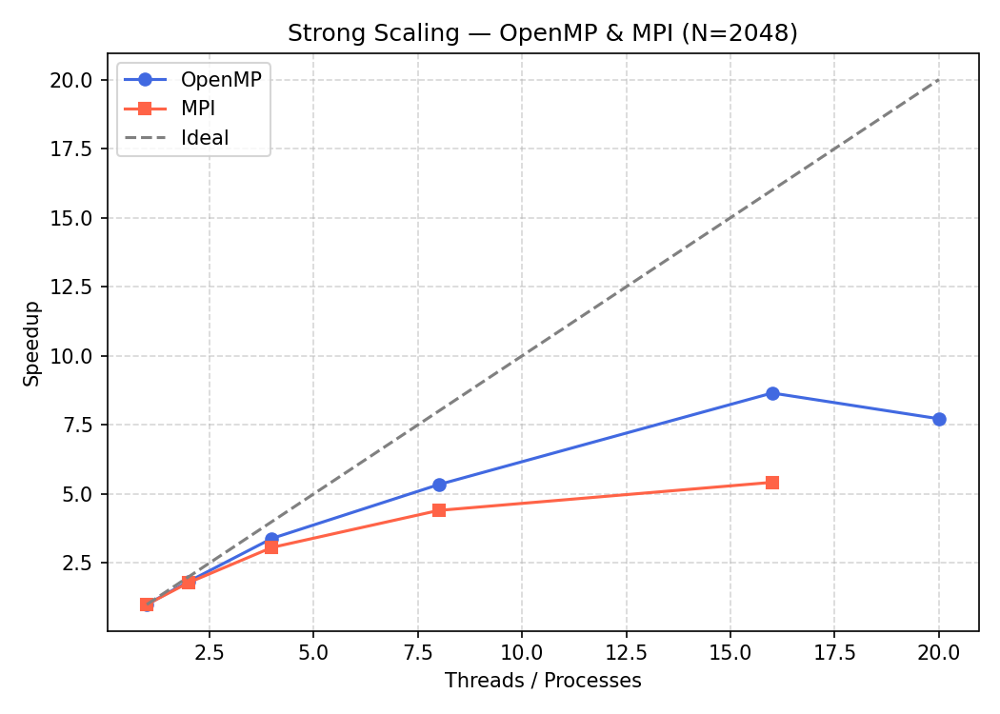
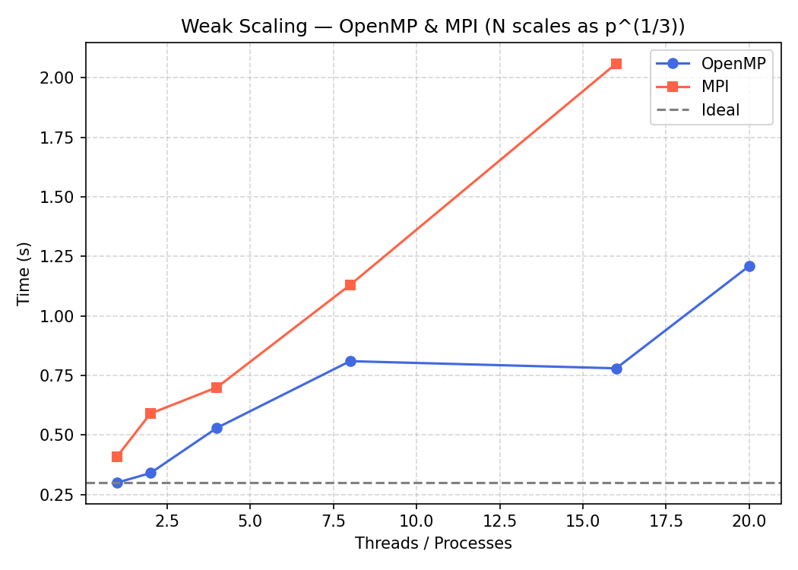
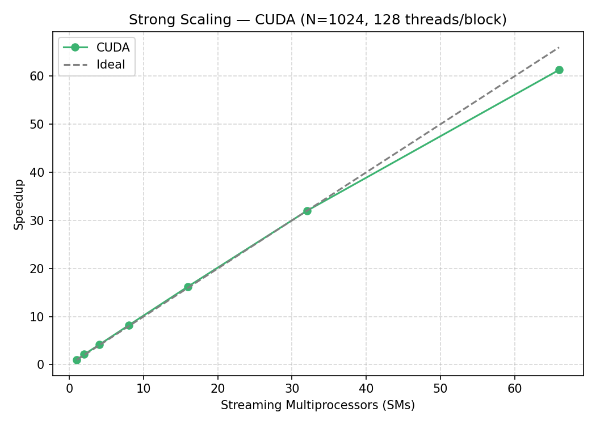
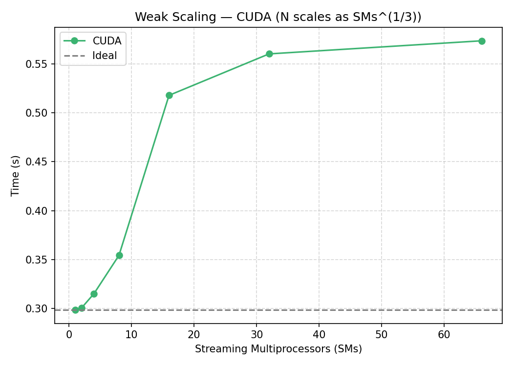
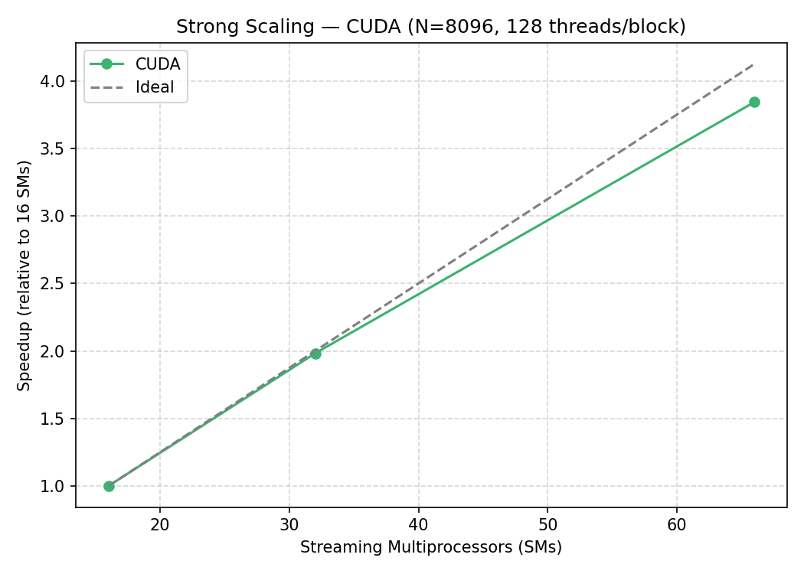
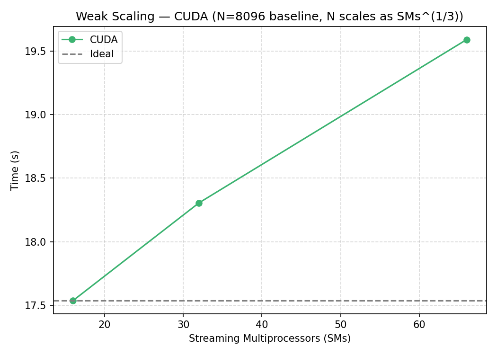

# Parallel Matrix-Matrix Multiplication (DM8100 – High Performance Computing)

Exam project for DM8100 HPC at SDU (2026). Matrix-matrix multiplication `C = A × B` implemented with four approaches, and evaluated in terms of **strong** and **weak scaling**.

| File | Task | Description |
|------|------|-------------|
| `Task0.c` | Serial | Naive IJK reference + checksum for correctness |
| `Task1.c` | OpenMP | IJK vs IKJ loop order with `static`, `dynamic`, `guided` and `collapse(2)` |
| `Task2.c` | MPI | 1D row decomposition: `MPI_Bcast` (B), `MPI_Scatter` (A), `MPI_Gather` (C) |
| `Task3.cu` | CUDA | Grid-stride kernel, 128 threads/block, one block per SM |
| `strong_scaling.sh`, `weak_scaling.sh` | | Benchmark scripts for OpenMP and MPI |
| `plot_scaling.py` | | Generates the plots below |

All implementations produce the same checksum as the serial version (`268348074.749542` for N=1024).

## Build & run

```bash
gcc -O2 -o task0 Task0.c                 && ./task0 1024
gcc -O2 -fopenmp -o task1 Task1.c        && OMP_NUM_THREADS=16 ./task1 1024
mpicc -O2 -o task2 Task2.c               && mpirun -n 4 ./task2 1024
nvcc -O2 -arch=sm_89 -o task3 Task3.cu   && ./task3 1024 66   # N, number of SMs
```

## Results (N=1024)

| Implementation | Time | Speedup vs serial |
|----------------|------|-------------------|
| Serial (IJK) | 3.44 s | 1× |
| MPI (4 processes) | 0.19 s | ~18× |
| OpenMP (IKJ, guided, 20 threads) | 0.037 s | ~92× |
| CUDA (RTX 4070 Ti Super, 66 SMs) | 0.0048 s | ~716× |

## Plots

### Strong scaling – OpenMP & MPI (N=2048)


Fixed problem size, more threads/processes. OpenMP reaches 8.7× at 16 threads but drops at 20, since the last 4 cores are slower efficiency cores. MPI only reaches 5.4× at 16 processes due to the cost of broadcasting all of B plus scatter/gather.

### Weak scaling – OpenMP & MPI


Work per thread/process is kept constant by growing N as p^(1/3) (since the work grows as N³). Ideal is a flat line. OpenMP goes from 0.30 s to 1.21 s (memory/cache pressure); MPI rises more steeply (0.41 s to 2.06 s) because the broadcast of B grows with N².

### Strong scaling – CUDA (N=1024)


The number of SMs (blocks) is varied from 1 to 66. Speedup reaches 61.3× at 66 SMs – almost ideal linear scaling.

### Weak scaling – CUDA


N scales as SMs^(1/3). The time only rises from 0.30 s to 0.57 s despite 66× more work, since there is no communication between SMs.

### Strong and weak scaling – CUDA (N=8096)



The same experiments at the large problem size (16, 32 and 66 SMs). Strong scaling stays close to ideal (17.5 s → 4.6 s), and weak scaling stays almost flat (17.5 s → 19.6 s).

## Key takeaways
- **Loop order matters:** IKJ is ~6–7× faster than IJK because B and C are accessed row-wise (cache-friendly) instead of jumping N elements per step.
- **Scheduling:** `guided` gave the best OpenMP performance.
- **Communication is the MPI bottleneck:** broadcasting the full B matrix limits both strong and weak scaling.
- **GPU wins clearly:** thousands of threads and no inter-process communication give near-ideal scaling.
